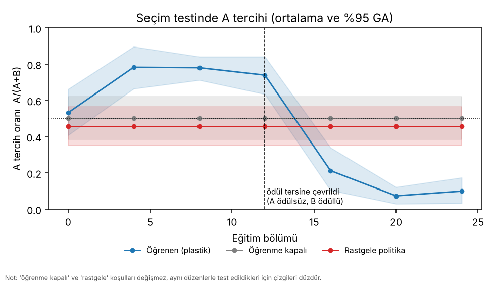
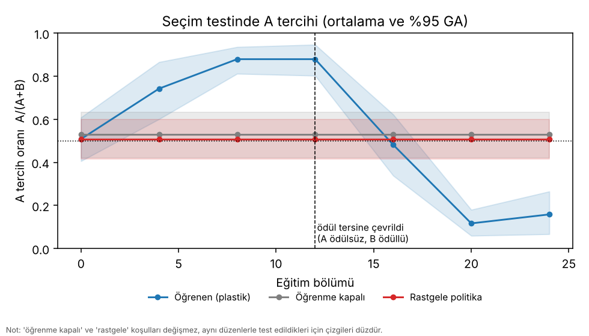
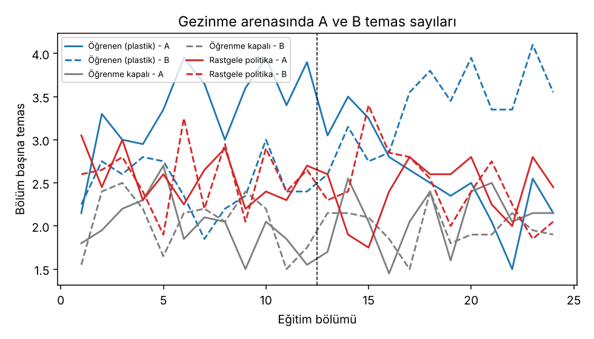
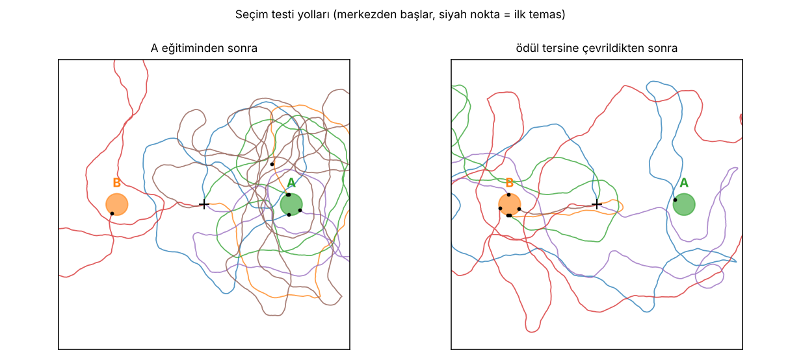

# Evre 1 sonuçları

Bu belge, Evre 1 deneylerinin **ölçülmüş** sonuçlarını, yaşanan bir hatayı ve sonuçların sınırlarını anlatır.
Tüm sayılar `python -m sinek.experiments.evre1` ile üretilmiştir; komutlar ve ayarlar en altta.

## Kısa özet

Sinek beyninin mantar cismi mimarisinden esinlenen, canlı başına **2 232 nöronluk spiking** bir ağ, sanal bir arenada
**iki ayrı tohumla (iki ayrı kablolama + koku çifti)** şunları yaptı:

1. **Öğrendi.** Başta A ve B kokusuna karşı tercihi yoktu. A kokusu tatlı ödülle eşleşince seçim testinde A'yı
   seçme oranı 0,50 civarından **0,74 ve 0,88**'e çıktı. Öğrenmesi kapalı ve rastgele gezinen kontrol canlılar 0,5'te kaldı.
2. **Hatırladı.** Öğrenilmiş sinapslar diske yazılıp sıfırdan kurulan yeni bir canlıya yüklendiğinde ağırlıklar ve
   davranış **birebir** aynıydı.
3. **Kararını değiştirdi.** Ödül B'ye taşınınca A tercihi **0,10 ve 0,16**'ya düştü (B tercih edildi).

Önceden yazılmış 6 başarı ölçütünün **ikisinde de altısı geçti** (aşağıda). Bu, **sentetik bir devre ve sanal bir dünya**
için geçerlidir; gerçek sinek verisi kullanılmadı ve gerçek sinek davranışı hakkında iddia taşımaz.

## Ayarlar

| | |
|---|---|
| Canlı | PN 80, KC 2 000, MBON 128, tat/temas 24 = **2 232 nöron** (APL ve DAN spiking değil, sayıya dahil değil) |
| Koşullar | `plastic` (öğrenme açık), `frozen` (aynı deneyim, öğrenme kapalı), `random` (dönüş kazancı 0) |
| Canlı sayısı | koşul başına 20 (toplam 60, aynı batch) |
| Eğitim | A için 12 bölüm, ödül tersine çevirmede 12 bölüm; bölüm = 60 sanal saniye serbest keşif |
| Seçim testi | canlı başına 6 deneme, 40 sn zaman sınırı, öğrenme kapalı; ilk temas = seçim |
| Tohumlar | **10** ve **11** (kablolama, koku desenleri ve rastgele düzenler tohumdan gelir) |
| Süre | ~33 dk ve ~31 dk (CPU, 4 çekirdek) |

## Başarı ölçütleri (sonuçlardan önce yazıldı)

| Ölçüt | Tohum 10 | Tohum 11 |
|---|---|---|
| **A1** Eğitilmiş `plastic` A-tercihi > 0,5 (GA alt sınırı) | **PASS** 0,74 [0,64; 0,84] | **PASS** 0,88 [0,80; 0,95] |
| **A2** `plastic` > `frozen` ve > `random` (p < 0,01) | **PASS** p = 0,0067 / 0,0008 | **PASS** p = 0,0001 / < 0,0001 |
| **A3** Naif canlının tercihi yok (GA 0,5'i kapsar) | **PASS** 0,53 [0,41; 0,66] | **PASS** 0,51 [0,41; 0,61] |
| **C** Yeniden yüklenen canlı birebir aynı | **PASS** | **PASS** |
| **B1** Tersine çevirmede A-tercihi anlamlı düşer (p < 0,01) | **PASS** 0,74 → 0,10 | **PASS** 0,88 → 0,16 |
| **B2** Tersine çevirmeden sonra B tercih edilir (GA üst sınırı < 0,5) | **PASS** 0,10 [0,03; 0,17] | **PASS** 0,16 [0,07; 0,27] |

Tohum 10'da A2'nin `frozen` karşılaştırması eşiğe yakın (p = 0,0067). Bu ölçütten geçti, ama marjı dar.

## Seçim testi: A tercih oranı A/(A+B)

Ortalama [%95 bootstrap GA, canlılar üzerinden]; 0,5 = tercih yok.

**Tohum 10**

| Aşama | Bölüm | plastic | frozen | random |
|---|---:|---|---|---|
| naif | 0 | 0,53 [0,41; 0,66] | 0,50 [0,38; 0,62] | 0,46 [0,35; 0,57] |
| A eğitimi | 4 | 0,78 [0,66; 0,90] | 0,50 | 0,46 |
| A eğitimi | 8 | 0,78 [0,71; 0,84] | 0,50 | 0,46 |
| A eğitimi | 12 | 0,74 [0,64; 0,84] | 0,50 | 0,46 |
| ödül B'ye taşındı | 16 | 0,21 [0,10; 0,34] | 0,50 | 0,46 |
| ödül B'ye taşındı | 20 | 0,07 [0,03; 0,12] | 0,50 | 0,46 |
| ödül B'ye taşındı | 24 | 0,10 [0,03; 0,17] | 0,50 | 0,46 |

**Tohum 11**

| Aşama | Bölüm | plastic | frozen | random |
|---|---:|---|---|---|
| naif | 0 | 0,51 [0,41; 0,61] | 0,53 [0,42; 0,63] | 0,51 [0,42; 0,60] |
| A eğitimi | 4 | 0,74 [0,60; 0,87] | 0,53 | 0,51 |
| A eğitimi | 8 | 0,88 [0,81; 0,94] | 0,53 | 0,51 |
| A eğitimi | 12 | 0,88 [0,80; 0,95] | 0,53 | 0,51 |
| ödül B'ye taşındı | 16 | 0,48 [0,34; 0,62] | 0,53 | 0,51 |
| ödül B'ye taşındı | 20 | 0,12 [0,06; 0,18] | 0,53 | 0,51 |
| ödül B'ye taşındı | 24 | 0,16 [0,07; 0,27] | 0,53 | 0,51 |

Notlar:
* `frozen` ve `random` aşamalar boyunca **aynı** değeri gösterir. Ağırlıkları/politikaları değişmediği ve tüm aşamalar aynı
  rastgele düzenlerle test edildiği için bu beklenen bir sonuçtur; yeni bağımsız ölçümler değildir.
* Tohum 10'da A tercihi 4. bölümde 0,78'e çıkıp 0,74–0,78'de kaldı; tohum 11'de 8. bölümde 0,88'e çıkıp orada kaldı.
  Yani öğrenme hızla doyuyor ve **kusursuz değil**: eğitimden sonra seçimlerin %12–26'sı hâlâ B'ye gidiyor.
* Seçim oranı (bir kaynağa ulaşan deneme oranı) eğitimli canlılarda ~0,82–0,93, naif canlılarda ~0,63–0,68.

## Gezinme arenasında davranış

Eğitim sırasında (bölüm 5–12, A ödüllü) `plastic` canlılar bölüm başına ortalama **3,6 A / 2,4 B** temas yaptı
(tohum 10: 3,60/2,41; tohum 11: 3,56/2,44). Kontroller dengeliydi: `frozen` 2,0/2,0, `random` 2,5/2,5.
Ödül tersine çevrildikten sonra (son 4 bölüm) `plastic` oran döndü: **2,1 A / 3,6 B** (tohum 10), **2,3 A / 3,5 B** (tohum 11).
Bu, tercihin yalnızca yapay seçim testinde değil, serbest keşifte de davranışı değiştirdiğini gösterir.






(Tohum 11 için `seed11_temaslar.png` ve `seed11_yollar.png` aynı klasörde.)

## Bir hata ve düzeltmesi (şeffaflık)

İlk iki koşu (tohum 0 pilotu ve tohum 1'deki ilk tam koşu) **geçersizdi** ve bu belgedeki sonuçlara dahil değildir.

* **Hata:** `choice_test` yeni bir `World` kuruyordu ve koku desenleri bu dünyanın **test tohumundan** üretiliyordu.
  Testteki "A" ve "B" bu yüzden canlının eğitimde öğrendiği kokular değildi; test, öğrenilmiş kokuyu değil, rastgele bir
  koku genellemesini ölçüyordu.
* **Nasıl fark edildi:** Tohum 1'deki ilk tam koşuda eğitilmiş canlıların A tercihi 0,34'e kadar düştü (GA [0,26; 0,42]),
  yani B'yi anlamlı biçimde tercih ettiler. Bunu gürültü saymadım, nedenini araştırdım. Tohum 0 pilotundaki 0,76'nın
  anlamı ise bilinmiyor: test kokuları eğitim kokularıyla yalnızca kısmen örtüşüyordu, bu sonuç da geçersiz sayıldı.
* **Düzeltme:** `World`, `patterns` parametresi aldı; seçim testi, yol kaydı ve checkpoint yükleme **eğitim dünyasının**
  koku desenlerini kullanır. Regresyon testleri eklendi. Eski kodla A öğretilmiş canlılar A'yı yalnızca %10–17
  seçiyordu, düzeltilmiş kodla testler (> %65) geçiyor.
* **Sonuçlara etkisi:** Aşağıdaki iki koşu düzeltilmiş kodla ve **daha önce hiç kullanılmamış tohumlarla** (10, 11) yapıldı.
* **Ayar seçimi:** Ölçek ayarları (koşul başına 20 canlı, 12 + 12 bölüm, canlı başına 6 deneme) geçersiz pilotun
  *gücüne* bakılarak seçildi; geçerli bir pilotla değil. Başarı ölçütlerine ve eşiklerine hiç dokunulmadı.

## Sınırlamalar ve dikkat edilmesi gerekenler

1. **İki tohum, iki ayrı beyin.** Her tohumda 20 canlı **aynı kablolamayı** paylaşır, yalnızca başlangıç sinaps
   gürültüsü, deneyim ve test düzenleri farklıdır. Canlılar arası GA bu varyasyonu ölçer; **farklı kablolamalar arası**
   varyasyonu yalnızca iki tohumun yan yana durması gösterir (tercih 0,74 ve 0,88).
2. **Koku kimliği dengelenmedi.** Her koşuda önce A ödüllenir, sonra B. Bir koku diğerinden daha "belirgin" olabilir
   (KC kablolaması o kokuyu daha çok KC'ye yayabilir). Tersine çevirmeden sonraki tercih (B için 0,90 ve 0,84) ile ilk
   öğrenilen tercih (A için 0,74 ve 0,88) benzer ama birebir değil. Koku kimliğinin etkisi ayrıca test edilmedi.
3. **Hareketin bir kısmı hazır.** İleri hız, "daha değerli antene dön" kuralı ve rastgele gezinme sabittir. Öğrenilen
   şey **hangi kokunun değerli olduğudur**; yürüyüşün kendisi değildir (`src/sinek/agent.py` başlığına bakın).
4. **Basitleştirmeler.** MBON'lar tür başına ortak sinaps vektörü kullanır; DAN ve APL spiking değildir; öğrenme STDP
   değil, KC etkinlik izine dayanır; parametreler model varsayımıdır (`README.md`).
5. **Gerçek veri yok.** Ağ FlyWire/MaleCNS'ten değil, sentetik olarak üretildi. "Gerçek sinek nöronlarıyla öğrendi"
   denemez.
6. **Hazır "açlık" yok.** Enerji izleniyor, ama karar vermeyi veya ödül büyüklüğünü etkilemiyor.
7. **GPU yolu test edilmedi.** Tüm koşular CPU'da yapıldı. `--device cuda` kodda var, çalıştırılıp doğrulanmadı.
8. **Aşamalar bağımsız örneklem değil.** Aynı canlılar ve aynı test düzenleri aşamalar boyunca kullanıldı.

## Yeniden üretme

```powershell
python -m sinek.experiments.evre1 --agents 20 --episodes 12 --reversal-episodes 12 --trials 6 --test-every 4 --seed 10 --out results\evre1
python -m sinek.experiments.evre1 --agents 20 --episodes 12 --reversal-episodes 12 --trials 6 --test-every 4 --seed 11 --out results\evre1_seed11
```

Tüm rastgelelik tohumdan gelir ve seçim testinin kaydet/yükle sonrası birebir tekrarı doğrulandı (C ölçütü). Ancak
**tüm koşunun** başka bir makinede ya da farklı iş parçacığı sayısıyla birebir aynı sayıları vereceği doğrulanmadı;
kayan noktalı toplama sırası küçük farklara yol açabilir.
Bu belgedeki sonuçlar PyTorch 2.14.1 (CPU), Python 3.13 ile alındı.
