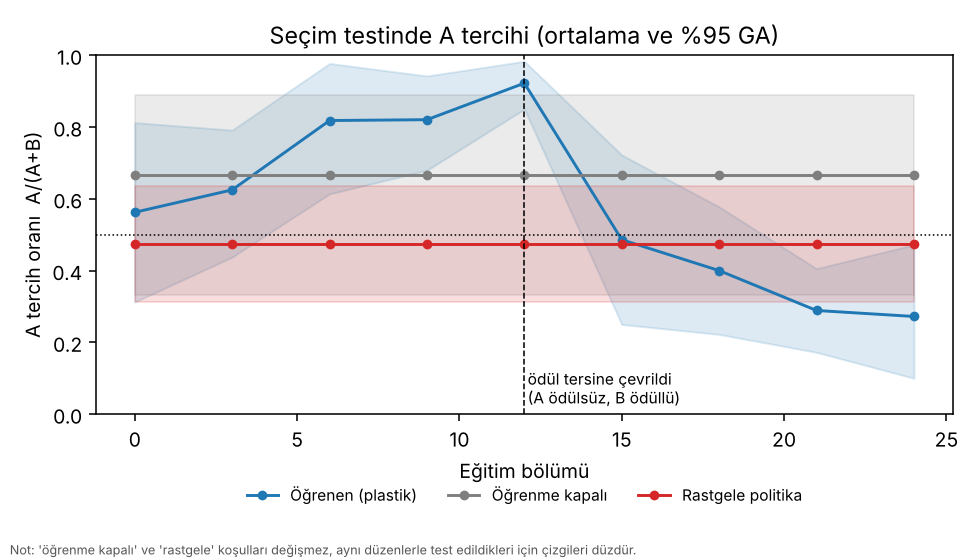
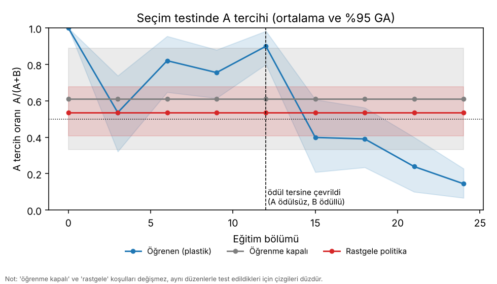

# Evre 2 sonuçları — gerçek mantar cismi bağlantısıyla koku/ödül öğrenme

Bu belge Evre 2'nin **ölçülmüş** sonuçlarını, **ön-kayıtlı ölçütlerin hükmünü (kısmen başarısız)** ve sonuçların sınırlarını anlatır.
Plan ve ölçütler koşulardan **önce** yazılıp commit edilmiştir: [`evre2_plan.md`](evre2_plan.md). Veri denetimi: [`evre2_veri_denetimi.md`](evre2_veri_denetimi.md).
Ek (ön-kayıtlı olmayan) analizler: [`evre2_ek_analiz.md`](evre2_ek_analiz.md).

## Kısa özet

Evre 1'deki sentetik mantar cismi (MB), **MaleCNS v1.0 bağlantı haritasının sağ yarımküre MB alt ağıyla** (PN 123, KC 2 045, APL 1, MBON 48,
DAN 161; canlı başına 4 780 nöron) değiştirildi; dünya, hareket kuralı ve deney hattı aynı kaldı. İki bağımsız doğrulayıcı koşuda (tohum 20 ve 21;
geliştirmede hiç kullanılmadı):

1. **Öğrenme gözlendi ve büyük.** A kokusu ödüllenince eğitilmiş canlıların seçim testinde A'yı seçme oranı **0,92 [0,85; 0,98]** ve **0,90 [0,80; 0,98]** oldu
   (rastgele politika 0,47 ve 0,54). Seçim yapabilen canlı oranı da arttı (naif 0,17 / 0,06 → 0,78 / 0,80).
2. **Ödül tersine çevrilince tercih döndü:** 0,92 → **0,27** ve 0,90 → **0,14** (p < 0,0001 her ikisinde).
3. **Bellek birebir korundu:** kaydedilip yeniden yüklenen canlının ağırlıkları ve test sonuçları aynıydı.
4. **Ancak ön-kayıtlı ölçütler karşılanmadı:** tohum 20'de **5/6**, tohum 21'de **4/6** geçti. Plan "hepsi iki koşuda sağlanmalı" dediği için **Evre 2 ölçütü başarısızdır**.
   Kalan iki ölçüt:
   * **A2** (plastic > frozen, p < 0,01) **iki koşuda da kaldı** (p = 0,063 ve 0,068). `random`'a karşı geçti (p = 0,0002 ve 0,0006).
   * **A3** (naif canlının tercihi yok) **tohum 21'de kaldı:** naif `plastic` tercihi 1,00 [1,00; 1,00] — yalnızca 4 canlı toplam 4 seçim yaptı ve hepsi A'ydı.

   Başarısızlıkların nedeni, ölçülen verilere göre, öğrenmenin zayıflığı değil **ölçüm gücü**: eğitimsiz ağ bir kaynağa nadiren ulaşıyor (64 denemeden 9–11 seçim), bu yüzden
   `frozen` (öğrenmesiz karşılaştırma) ve naif tercih çok az gözleme dayanıyor (aşağıda). Bu açıklama **koşulardan sonra** yapıldı; ön-kayıtlı hüküm değişmez.
5. **E1 (sınıf etiketi karıştırma kontrolü) ön-kayıtlı ölçütü formel olarak geçti** (iki karıştırmada p = 0,0012 ve 0,0054), ama karıştırılmış ağlar neredeyse hiç seçim yapmadığı
   için bu kanıt zayıftır (aşağıda).

Bu sonuçlar **sanal ortam, bu model ve tek bir erkek sinek bağlantı haritası** için geçerlidir; gerçek sinek davranışı hakkında iddia taşımaz.

## Ayarlar

| | |
|---|---|
| Veri | MaleCNS v1.0 (yayın 2026-06-08), CC BY 4.0, sağ yarımküre MB; indirme boyut+md5 doğrulamalı; çıkarılan alt ağ depoda (`data/processed/malecns_v1.0_R`) |
| Canlı | PN 123 (58 glomerül kanalı), KC 2 045, APL 1, MBON 48, DAN 161 + tat/temas nöronları = **4 780 nöron** |
| Koşullar | `plastic` (öğrenme açık), `frozen` (aynı deneyim, öğrenme kapalı), `random` (dönüş kazancı 0); aynı batch |
| Canlı sayısı | koşul başına 16 (toplam 48); "canlılar" **aynı bağlantının** gürültü / yol / başlangıç tekrarlarıdır |
| Eğitim | A için 12 bölüm, ödül tersine çevirmede 12 bölüm; bölüm = 60 sanal sn |
| Seçim testi | canlı başına 4 deneme, 40 sn zaman sınırı, öğrenme kapalı; ilk temas = seçim; her 3 bölümde bir |
| Tohumlar | **20** ve **21** (doğrulayıcı); geliştirme: 0 ve 1 |
| Koku çifti | tohum başına, **yalnızca eğitimsiz ağın iç eğilimine** göre iki aşamalı seçildi (tohum 20 → desen tohumu 7004, tohum 21 → 7122) |
| Süre | ~78 dk ve ~79 dk (CPU, 4 çekirdek, `--threads 2`, iki koşu eşzamanlı) |

## Ön-kayıtlı ölçütler

| Ölçüt | Tohum 20 | Tohum 21 |
|---|---|---|
| **A1** Eğitilmiş `plastic` A-tercihi > 0,5 (GA alt sınırı) | **PASS** 0,92 [0,85; 0,98] | **PASS** 0,90 [0,80; 0,98] |
| **A2** `plastic` > `frozen` ve > `random` (p < 0,01) | **FAIL** p(frozen) = 0,0629, p(random) = 0,0002 | **FAIL** p(frozen) = 0,0678, p(random) = 0,0006 |
| **A3** Naif canlının tercihi yok (GA 0,5'i kapsar) | **PASS** 0,56 [0,31; 0,81] | **FAIL** 1,00 [1,00; 1,00] (4 seçim) |
| **C** Yeniden yüklenen canlı birebir aynı | **PASS** | **PASS** |
| **B1** Tersine çevirmede A-tercihi anlamlı düşer (p < 0,01) | **PASS** 0,92 → 0,27, p < 0,0001 | **PASS** 0,90 → 0,14, p < 0,0001 |
| **B2** Tersine çevirmeden sonra B tercih edilir (GA üst sınırı < 0,5) | **PASS** 0,27 [0,10; 0,47] | **PASS** 0,14 [0,07; 0,23] |
| **Toplam** | **5 / 6** | **4 / 6** |

Ölçütler koşulardan sonra değiştirilmedi. Aşağıdaki "neden" çözümlemeleri ölçüt hükmünü etkilemez.

## Seçim testi: A tercih oranı A/(A+B)

Ortalama [%95 bootstrap GA, canlılar üzerinden]; 0,5 = tercih yok. Seçim oranı = bir kaynağa ulaşan deneme oranı (`plastic`).

**Tohum 20**

| Aşama | Bölüm | plastic | frozen | random | seçim oranı |
|---|---:|---|---|---|---:|
| naif | 0 | 0,56 [0,31; 0,81] | 0,67 [0,33; 0,89] | 0,47 [0,31; 0,64] | 0,17 |
| A eğitimi | 3 | 0,62 [0,44; 0,79] | 0,67 | 0,47 | 0,52 |
| A eğitimi | 6 | 0,82 [0,61; 0,98] | 0,67 | 0,47 | 0,56 |
| A eğitimi | 9 | 0,82 [0,68; 0,94] | 0,67 | 0,47 | 0,70 |
| A eğitimi | 12 | **0,92 [0,85; 0,98]** | 0,67 | 0,47 | 0,78 |
| ödül B'ye taşındı | 15 | 0,49 [0,25; 0,72] | 0,67 | 0,47 | 0,42 |
| ödül B'ye taşındı | 18 | 0,40 [0,22; 0,58] | 0,67 | 0,47 | 0,66 |
| ödül B'ye taşındı | 21 | 0,29 [0,17; 0,41] | 0,67 | 0,47 | 0,70 |
| ödül B'ye taşındı | 24 | **0,27 [0,10; 0,47]** | 0,67 | 0,47 | 0,69 |

**Tohum 21**

| Aşama | Bölüm | plastic | frozen | random | seçim oranı |
|---|---:|---|---|---|---:|
| naif | 0 | 1,00 [1,00; 1,00] | 0,61 [0,33; 0,89] | 0,54 [0,41; 0,68] | 0,06 |
| A eğitimi | 3 | 0,54 [0,32; 0,74] | 0,61 | 0,54 | 0,38 |
| A eğitimi | 6 | 0,82 [0,65; 0,96] | 0,61 | 0,54 | 0,64 |
| A eğitimi | 9 | 0,76 [0,61; 0,88] | 0,61 | 0,54 | 0,81 |
| A eğitimi | 12 | **0,90 [0,80; 0,98]** | 0,61 | 0,54 | 0,80 |
| ödül B'ye taşındı | 15 | 0,40 [0,21; 0,61] | 0,61 | 0,54 | 0,48 |
| ödül B'ye taşındı | 18 | 0,39 [0,23; 0,56] | 0,61 | 0,54 | 0,67 |
| ödül B'ye taşındı | 21 | 0,24 [0,10; 0,40] | 0,61 | 0,54 | 0,72 |
| ödül B'ye taşındı | 24 | **0,14 [0,07; 0,23]** | 0,61 | 0,54 | 0,73 |

`frozen` ve `random` değişmez (öğrenmezler) ve her aşamada aynı test düzenleriyle ölçülür; çizgileri bu yüzden düzdür. Aşamalar bağımsız örneklem değildir.




Yollar ve temas sayıları: [`img/evre2_s20_yollar.png`](img/evre2_s20_yollar.png), [`img/evre2_s20_temaslar.png`](img/evre2_s20_temaslar.png),
[`img/evre2_s21_yollar.png`](img/evre2_s21_yollar.png), [`img/evre2_s21_temaslar.png`](img/evre2_s21_temaslar.png).

## Başarısızlıkların çözümlemesi (post-hoc; ön-kayıtlı değil)

Ayrıntılı tablolar: [`evre2_ek_analiz.md`](evre2_ek_analiz.md) (`python -m sinek.experiments.evre2_posthoc` ile üretilir).

**Seçim sayıları** (64 denemede A / B ilk-temas; "seçim yapan canlı" ≥ 1 seçim yapan canlı sayısı, 16 üzerinden):

| | Tohum 20 | Tohum 21 |
|---|---|---|
| naif `plastic` | 6 A / 5 B (8 canlı) | 4 A / 0 B (**4 canlı**) |
| naif = `frozen` (aynı ağ) | 6 A / 3 B (9 canlı) | 6 A / 4 B (9 canlı) |
| eğitilmiş `plastic` (bölüm 12) | **46 A / 4 B** (15 canlı) | **46 A / 5 B** (15 canlı) |
| `random` | 21 A / 23 B (16 canlı) | 23 A / 23 B (16 canlı) |
| tersine çevirme sonrası `plastic` (bölüm 24) | 14 A / 30 B (15 canlı) | 7 A / 40 B (15 canlı) |

* **Eğitimsiz ağ bir kaynağa nadiren ulaşıyor** (64 denemede 4–11 seçim; `random`: 44–46). Bu yüzden `frozen` ölçümü 9 canlıya ve ~10 seçime dayanıyor; A2'de `frozen`'a karşı canlı başına
  tercih ortalamaları karşılaştırılırken (ön-kayıtlı test) bu az sayıda gözlem p < 0,01'e ulaşmayı çok zorlaştırıyor. **Olası neden (doğrulanmadı):** eğitimsiz ağ koku girdisine hafif negatif
  değer veriyor (plan §4.2d) ve canlı, değeri daha düşük antenden uzaklaşıyor; `random` politikada dönüş kazancı 0 olduğu için böyle bir kaçınma yok.
* **A3 / tohum 21:** naif `plastic` tercihi 4 seçime dayanıyor (hepsi A). Aynı ağın (`frozen`) 10 seçimi 6 A / 4 B (0,60 [0,33; 0,89]). Havuzlanmış naif seçimler (10 A / 4 B) 0,5'ten
  istatistiksel olarak ayırt edilemiyor (tam iki terimli p = 0,18; denemelerin bağımsız olduğu varsayımıyla). GA'nın [1,00; 1,00] çıkması, 4 canlının hepsinin A seçmesinden doğan bir **bootstrap bozulması**; ölçüt
  yazıldığı gibi başarısız sayıldı.
* **Post-hoc, daha güçlü karşılaştırmalar** (canlı-düzeyi permütasyon, tek yönlü, seçim sayısı ağırlıklı; **koşulardan sonra seçildi, ön-kayıtlı değil**):

  | | Tohum 20 | Tohum 21 |
  |---|---|---|
  | eğitilmiş `plastic` > `frozen` | 0,92 vs 0,67; p = 0,0011 | 0,90 vs 0,60; p = 0,0009 |
  | eğitilmiş `plastic` > naif (plastic + frozen, aynı ağ) | 0,92 vs 0,60; p < 0,0001 | 0,90 vs 0,71; p = 0,0205 |
  | eğitilmiş A-`plastic` > tersine çevrilmiş | 0,92 vs 0,32; p = 0,0001 | 0,90 vs 0,15; p < 0,0001 |

  Bunlar yalnızca "ön-kayıtlı A2'nin başarısızlığı ölçüm gücünden kaynaklanıyor" okumasını destekler; A2'nin kendi hükmünü (FAIL) değiştirmez. Tohum 21'de naif ağa karşı p = 0,0205 olması,
  naif havuzda A'ya doğru hafif bir yanlılığın (0,71, 14 seçime dayanıyor) etkisini gösterir ve **0,01'in üzerindedir**.

## E1 — MBON "yaklaş / kaçın" sınıf etiketlerinin karıştırılması

Bağlantı, DAN→MBON bölme eşlemesi ve koku çifti (desen tohumu 7004) aynı; yalnızca hangi MBON'un "yaklaş" / "kaçın" sayıldığı rastgele permütasyonla (tohum 1 ve 2) karıştırıldı.
Ön-kayıtlı ölçüt: A eğitimi sonunda `plastic` A-tercihi gerçek-etiketli koşudan düşük (tek yönlü permütasyon p < 0,01). Karıştırma koşuları A için 12 bölüm koştu; tersine çevirmede yalnızca 3 bölüm
(ölçüt yalnızca A eğitimi sonundaki aşamayı kullanır).

| koşu | sınıf dengesi | naif `plastic` | eğitilmiş `plastic` A-tercihi [GA] | seçim yapan canlı | seçim oranı | p (gerçek > karıştırılmış) | E1 |
|---|---:|---|---|---:|---:|---:|---|
| gerçek etiketler | 1,210 | 0,56 | 0,92 [0,85; 0,98] | 15 / 16 | 0,78 | — | — |
| karıştırma 1 | 1,258 | 0,83 (7 A / 1 B) | 0,17 [0,00; 0,50] | **3 / 16** | **0,06** | 0,0012 | **PASS** |
| karıştırma 2 | 1,197 | 0,00 (0 A / 10 B) | 0,52 [0,24; 0,79] | 11 / 16 | 0,22 | 0,0054 | **PASS** |

**Yorum ve uyarılar.** Ölçüt iki karıştırmada da geçti; gerçek sınıf yapısı olmadan model, aynı eğitim süresinde A'ya yönelmeyi öğrenmedi. Ancak:

* Karıştırma 1'de eğitilmiş `plastic` yalnızca 3 canlıda 4 seçim üretti. Bu sonuç "A'yı öğrenmedi" değil, "neredeyse hiçbir kaynağa ulaşmadı" demektir; temas sayısı bölüm başına 0,44 A (gerçek: 2,75).
  Yani karıştırılmış etiketlerle öğrenme **davranışı bozuyor**, ama bozulmanın yönü ve mekanizması bu veriden çıkarılamaz.
* Aynı koku çifti karıştırılmış etiketlerde eğitimsiz ağda çok daha büyük bir iç A–B farkı veriyor (aynı hesapla iç fark skoru: gerçek etiketler 0,013, karıştırma 1: 0,208, karıştırma 2: 0,275) ve naif tercih iki koşuda zıt yönde
  (0,83 ve 0,00; 8 ve 10 seçime dayanıyor). Koku çifti gerçek etiketler için seçildiğinden, E1 karşılaştırması bu bakımdan karıştırılmış koşulları **haksız dezavantajlı** kılmış olabilir.
  Çifti karıştırılmış ağda yeniden seçmek daha adil bir kontrol olurdu; yapılmadı.
* Yalnızca iki karıştırma tohumu denendi.

Sonuç: ölçüt geçti; "bölme / sınıf yapısı modelde işe yarıyor" yönünde **zayıf ama tutarlı** bir kanıttır, ikna edici bir kanıt değildir.

## Betimsel ablasyon: yalnızca baskılanma (`cbrain.restore=false`)

Ön-kayıt planında ölçütsüz bir betimsel kontrol olarak yazılmıştı (tohum 20 kurulumu, aynı koku çifti). Koşu sürüyor; sonuç bu bölüme eklenecek.

## Evre 1 ile karşılaştırma

| | Evre 1 (sentetik MB, tohum 10 / 11) | Evre 2 (gerçek MB alt ağı, tohum 20 / 21) |
|---|---|---|
| Canlı / koşul | 20 | 16 |
| Eğitilmiş A-tercihi | 0,74 / 0,88 | 0,92 / 0,90 |
| Tersine çevirmeden sonra | 0,10 / 0,16 | 0,27 / 0,14 |
| Naif tercih | 0,53 / 0,51 | 0,56 / 1,00 (4 seçim) |
| Ölçüt | 6/6 ve 6/6 | 5/6 ve 4/6 |

Evre 2'de eğitilmiş tercih Evre 1 kadar yüksek, ama **ölçüt gücü açısından daha zayıf**: eğitimsiz ağ az seçim yapıyor (naif seçim oranı 0,17 ve 0,06). Evre 1'den farklı olarak Evre 2 için geliştirme sırasında dünya
(σ = 6, doygunluk 2), dönüş kazancı (40), `valence_gain` (10) ve plastisite kuralı (iki yönlü sınırlı) ayarlandı (`evre2_plan.md` §4); bunlar geliştirme tohumlarında (0, 1) seçildi, doğrulayıcı tohumlarda (20, 21) değişmedi.

## Sınırlamalar ve dikkat edilmesi gerekenler

1. **Ön-kayıtlı ölçütler karşılanmadı** (5/6 ve 4/6). Başarısızlık nedeninin ölçüm gücü olduğu yönündeki okuma **koşulardan sonra** yapıldı.
2. **Tek bağlantı haritası.** Tek erkek sinek, tek yarımküre; iki anten aynı kablolamayı kullanır. "Canlılar" gürültü tekrarlarıdır; sinekler arası değişkenliği temsil etmez.
3. **Varsayımlar sonuçları belirler.** Sinaps sayısı → ağırlık dönüşümü, MBON "yaklaş/kaçın" sınıfının DAN bölme payından türetilmesi, "tüm PAM = ödül" ve delta kuralı (`temas·(0,6·ödül − V)`) model varsayımıdır;
   MBON→DAN geri beslemesi ve KC→KC bağlantıları modelde yok. E1 yalnızca sınıf türetimini sınar ve zayıf kalır.
4. **Nörotransmitter değerleri sınıflandırıcı tahminidir**; DPM yanlış tahmin edildiği için kullanılmadı.
5. **Geliştirme tohumlarında ayarlama yapıldı** (dönüş kazancı, dünya, plastisite kuralı). Pilot koşu başarısız olmuştu; nedenler ve düzeltmeler `evre2_plan.md` §4'te. Doğrulayıcı tohumlar bundan bağımsızdır ama
   aynı model ailesinde kalındı.
6. **Hareketin kendisi hazır.** Sabit hız, "değeri yüksek antene dön", rastgele gezinme elle yazılmıştır; öğrenilen yalnızca değerdir.
7. **Eğitimsiz ağ az seçim yapıyor** (kaynağa nadiren ulaşıyor); bu hem ölçüm gücünü düşürüyor hem de öğrenmenin bir kısmının "ağın harekete geçmesi" olarak görünmesine yol açabilir (seçim oranı 0,17 → 0,78).
8. **Aşamalar bağımsız örneklem değil** ve canlılar aynı bağlantının tekrarlarıdır; GA'lar canlılar-arası gürültüyü ölçer.
9. **GPU yolu test edilmedi**; tüm koşular CPU'da yapıldı.
10. **Birebir tekrarlanabilirlik:** kaydet/yükle testi birebir doğrulandı (C). Tüm koşunun başka makine veya farklı iş parçacığı sayısıyla birebir aynı sayıları verdiği doğrulanmadı.

## Yeniden üretme

Veriyi indirme ve çıkarma (bir kez): `python -m sinek.connectome.fetch` ve `python -m sinek.connectome.malecns` ([`../data/README.md`](../data/README.md)); çıkarılan alt ağ depoda hazırdır.

```powershell
python -m sinek.experiments.evre2 --agents 16 --episodes 12 --reversal-episodes 12 --test-every 3 --trials 4 --seed 20 --threads 2 --out results\evre2_s20
python -m sinek.experiments.evre2 --agents 16 --episodes 12 --reversal-episodes 12 --test-every 3 --trials 4 --seed 21 --threads 2 --out results\evre2_s21
# E1 (aynı koku çifti; sınıf etiketleri karıştırılır)
python -m sinek.experiments.evre2 --agents 16 --episodes 12 --reversal-episodes 3 --test-every 3 --trials 4 --seed 20 --pattern-seed 7004 --set cbrain.class_shuffle_seed=1 --threads 2 --out results\evre2_s20_shuffle1
python -m sinek.experiments.evre2 --agents 16 --episodes 12 --reversal-episodes 3 --test-every 3 --trials 4 --seed 20 --pattern-seed 7004 --set cbrain.class_shuffle_seed=2 --threads 2 --out results\evre2_s20_shuffle2
# ek analizler
python -m sinek.experiments.evre2_posthoc --runs results\evre2_s20 results\evre2_s21 --shuffle results\evre2_s20_shuffle1 results\evre2_s20_shuffle2 --out docs\evre2_ek_analiz.md
```

Sonuçlar PyTorch (CPU), Python 3.13 ile alındı; `results.json` içinde `git_commit` ve tüm kalibrasyon değerleri kayıtlıdır.

Veri: MaleCNS connectome, FlyEM (HHMI Janelia), Cambridge Zoology, MRC LMB ve Google Research işbirliği; CC BY 4.0. Atıf bilgisi: [`evre2_veri_denetimi.md`](evre2_veri_denetimi.md).
