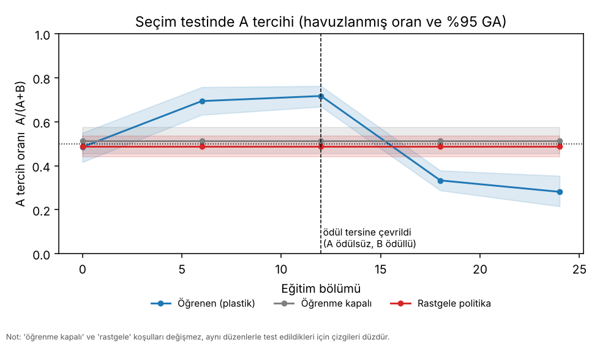
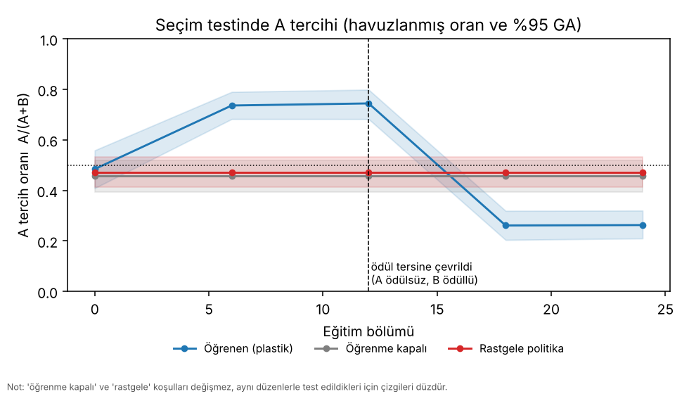

# Evre 2b sonuçları — gerçek mantar cismi bağlantısıyla koku/ödül öğrenme (artırılmış ölçüt gücü)

Plan ve ölçütler koşulardan **önce** yazılıp commit edilmiştir: [`evre2b_plan.md`](evre2b_plan.md) (kesinleşmiş sürüm `aed8716`, doğrulayıcı koşular ondan sonra başladı). Güç analizi:
[`evre2b_guc_analizi.md`](evre2b_guc_analizi.md). Evre 2'nin (v1) sonuçları ve hükmü: [`evre2_sonuclar.md`](evre2_sonuclar.md) — **değişmedi**.

## Kısa özet

İki bağımsız doğrulayıcı koşuda (tohum **30** ve **31**; geliştirmede hiç kullanılmadı) ön-kayıtlı **7 ölçütün 7'si de geçti** (G, A1, A2, A3, C, B1, B2). Ön-kayıtlı karar kuralı
("hepsi iki koşuda da") gereği hüküm: **Evre 2b ölçütü başarılı.** (Yapısal kontrol E1 ana karar kuralının parçası değildir; sonucu aşağıda: **E1 genel FAIL**.)

| | Tohum 30 | Tohum 31 |
|---|---|---|
| A tercihi, eğitimsiz (`plastic`+`frozen`) | 0,50 [0,45; 0,54] | 0,47 [0,42; 0,52] |
| A tercihi, A eğitiminden sonra (`plastic`, bölüm 12) | **0,72** [0,67; 0,76] | **0,74** [0,68; 0,80] |
| `frozen` / `random` kontrol | 0,51 / 0,49 | 0,46 / 0,47 |
| A tercihi, ödül B'ye taşındıktan sonra (bölüm 24) | **0,28** [0,22; 0,35] | **0,26** [0,21; 0,32] |
| seçim oranı, eğitimsiz → eğitilmiş | 0,54 → 0,86 | 0,60 → 0,83 |
| yeniden yüklenen canlı birebir aynı | evet | evet |
| Ölçütler | **7 / 7** | **7 / 7** |

**Bu sonucun anlamı ve sınırı:**

* **Evre 2 v1'in hükmünü geri almaz.** v1 "başarısız"dır; Evre 2b *yeni bir ön-kayıt*tır (yeni hareket okuması, yeni istatistik, yeni ölçütler, yeni tohumlar). v1'deki iki ölçüt ölçüm gücü
  yüzünden kalmıştı; Evre 2b o gücü artırdı ve aynı soruyu yeniden sordu (plan §1–§3).
* **Etki büyüklüğü orta düzeydedir, v1'deki kadar büyük değil:** eğitilmiş A tercihi 0,72–0,74 (v1'de 0,90–0,92). Nedeni, v1'in "keskin" dönüş kuralının yerine güvenilir ölçüm sağlayan
  yaklaşık doğrusal bir okumanın konması (plan §2): ölçüm daha güvenilir, davranış daha az keskin. İki sonuç doğrudan karşılaştırılamaz.
* **Tersine çevirme güçlü:** 12 bölümden sonra eğitilmiş canlıların A'yı seçme oranı 0,28 / 0,26'ya indi (B artık tercih ediliyor); 24 canlıdan 19 ve 21'i B'yi A'ya tercih ediyor (post-hoc betimsel).
* Sonuçlar **sanal ortam, bu model ve tek bir erkek sinek bağlantı haritası** için geçerlidir; gerçek sinek davranışı hakkında iddia taşımaz.

## Ayarlar (plan §3, §7)

| | |
|---|---|
| Veri | MaleCNS v1.0 sağ yarımküre MB alt ağı (PN 123, KC 2 045, APL 1, MBON 48, DAN 161; canlı başına 4 780 nöron), v1 ile aynı |
| Hareket okuması | `contrast_eps = 2,0`, `turn_gain = 60` (dev. tohumları 2 ve 3'te, §4.4 kuralıyla seçildi; donduruldu: `evre2.V2_SET`) |
| Koşullar | `plastic`, `frozen`, `random`; koşul başına **24** canlı, **rol-dengeli** (her koşulda yarısında A rolü = koku 1); canlı başına **16** deneme |
| Eğitim | A için 12 bölüm, tersine çevirmede 12 bölüm; bölüm = 60 sanal sn; testler naif, 6, 12, 18, 24 |
| İstatistik | seçim sayısı ağırlıklı, canlı-düzeyi (küme) bootstrap (n = 10 000) ve permütasyon (n = 20 000); α = 0,01 |
| Tohumlar | **30** ve **31** (doğrulayıcı); koku çifti: 8037 ve 8108 (yalnız eğitimsiz ağın iç eğilimine göre seçildi) |
| Süre | 205 ve 200 dk (2 iş parçacığı, iki koşu yan yana) |

## Ölçütler

| Ölçüt | Tohum 30 | Tohum 31 |
|---|---|---|
| **G** seçim oranı (eğitimsiz, eğitilmiş) ≥ 0,40 | **PASS** — 0,54 (418 seçim), 0,86 | **PASS** — 0,60 (459 seçim), 0,83 |
| **A1** eğitilmiş A tercihi GA alt sınırı > 0,5 | **PASS** — 0,72 [0,67; 0,76] (236 A / 93 B) | **PASS** — 0,74 [0,68; 0,80] (236 A / 81 B) |
| **A2** `plastic` > `frozen` ve > `random` (p < 0,01) | **PASS** — p(frozen) = 0,0001, p(random) < 0,0001 | **PASS** — p(frozen) < 0,0001, p(random) < 0,0001 |
| **A3** eğitimsiz rol tercihi GA ⊂ [0,30; 0,70] | **PASS** — 0,50 [0,45; 0,54] | **PASS** — 0,47 [0,42; 0,52] |
| **C** kaydet/yükle birebir aynı | **PASS** | **PASS** |
| **B1** A12 → B24 anlamlı düşüş (p < 0,01) | **PASS** — 0,72 → 0,28, p < 0,0001 | **PASS** — 0,74 → 0,26, p < 0,0001 |
| **B2** B24'te GA üst sınırı < 0,5 | **PASS** — 0,28 [0,22; 0,35] | **PASS** — 0,26 [0,21; 0,32] |

(p değerleri en küçük çözünürlük 1/20 001 olan permütasyon sınırındadır; "< 0,0001" demek 20 000 permütasyonda hiçbirinin gözlenen farka ulaşmadığı anlamına gelir.)

## Aşama aşama (havuzlanmış rol-A oranı, %95 küme GA)

**Tohum 30**

| Aşama | plastic | frozen | random | seçim oranı (p/f/r) |
|---|---|---|---|---|
| naif | 0,49 [0,42; 0,55] | 0,51 [0,45; 0,57] | 0,49 [0,44; 0,54] | 0,54 / 0,55 / 0,71 |
| A, bölüm 6 | 0,69 [0,63; 0,76] | 0,51 | 0,49 | 0,85 / 0,55 / 0,71 |
| A, bölüm 12 | **0,72** [0,67; 0,76] | 0,51 | 0,49 | 0,86 / 0,55 / 0,71 |
| B, bölüm 18 | 0,33 [0,29; 0,38] | 0,51 | 0,49 | 0,91 / 0,55 / 0,71 |
| B, bölüm 24 | **0,28** [0,22; 0,35] | 0,51 | 0,49 | 0,85 / 0,55 / 0,71 |

**Tohum 31**

| Aşama | plastic | frozen | random | seçim oranı (p/f/r) |
|---|---|---|---|---|
| naif | 0,48 [0,41; 0,56] | 0,46 [0,39; 0,52] | 0,47 [0,41; 0,53] | 0,59 / 0,60 / 0,70 |
| A, bölüm 6 | 0,74 [0,68; 0,79] | 0,46 | 0,47 | 0,85 / 0,60 / 0,70 |
| A, bölüm 12 | **0,74** [0,68; 0,80] | 0,46 | 0,47 | 0,83 / 0,60 / 0,70 |
| B, bölüm 18 | 0,26 [0,20; 0,32] | 0,46 | 0,47 | 0,82 / 0,60 / 0,70 |
| B, bölüm 24 | **0,26** [0,21; 0,32] | 0,46 | 0,47 | 0,87 / 0,60 / 0,70 |

`frozen` ve `random` çizgileri düzdür çünkü bu koşullar değişmez ve her aşamada aynı düzenlerle test edilir (tek bir gerçekleşme; aşamalar bağımsız örneklem değildir).

Grafikler: öğrenme eğrisi ([s30](img/evre2b_s30_ogrenme_egrisi.png), [s31](img/evre2b_s31_ogrenme_egrisi.png)), eğitim sırasında temas sayıları
([s30](img/evre2b_s30_temaslar.png), [s31](img/evre2b_s31_temaslar.png)), seçim testi yolları ([s30](img/evre2b_s30_yollar.png), [s31](img/evre2b_s31_yollar.png)).




## Ek betimsel gözlemler (post-hoc, ölçüt değil)

* **Canlı düzeyinde tutarlılık:** A12'de 24 `plastic` canlıdan **22'si** (iki tohumda da) A'yı B'ye tercih etti; B24'te 19/24 ve 21/24 canlı B'yi tercih etti.
* **Koku kimliğinden bağımsız:** A rolü koku 0 iken tercih 0,71 / 0,76, A rolü koku 1 iken 0,72 / 0,73 — öğrenilen şey belirli bir kokunun kimliği değil, ödül rolüdür. (Rol dengelemesinin amacı buydu.)
* **Eğitimsiz koku yanlılığı küçük:** koku-0 oranı 0,50 [0,45; 0,54] ve 0,44 [0,39; 0,48] (ikinci tohumda koku 1'e hafif eğilim); rol dengelemesi bunu A-tercihi ölçütlerinden çıkarır.
* **Canlılar arası aşırı yayılım:** gözlenen/iki terimli varyans oranı A12'de 0,95 ve 1,45, B24'te 2,0 ve 1,4 (24 canlı; belirsiz). Güç analizindeki "aşırı yayılım yok" varsayımı yaklaşık geçerli, B24'te biraz zayıf.
* **Geliştirme ile doğrulama uyumu:** geliştirme provası (tohum 3, 24 canlı, 8 deneme, aynı kazanç) A12'de 0,71, B24'te 0,32 vermişti; doğrulayıcılarda 0,72 / 0,74 ve 0,28 / 0,26. Geliştirmeden doğrulamaya belirgin bir iyimserlik farkı görülmedi.
* **Pilottaki A6→A12 düşüşü tekrarlanmadı** (tohum 30: 0,69 → 0,72; tohum 31: 0,74 → 0,74). Pilotta açıklanmayan bu düşüşün nedeni hâlâ bilinmiyor, ama sorun olarak görünmüyor.
* **Güç analiziyle uyum:** gözlenen etki (0,72–0,74 → 0,26–0,28) güç analizindeki "güçlü" senaryoya yakın (24 × 16'da tüm ölçütleri geçme olasılığı ≈ 1,00); sonuç beklenenle tutarlı.

## Sınırlamalar ve dikkat edilecek şeyler

1. **Ölçütlerin hepsi geçmesi, modelin gerçek sineği temsil ettiği anlamına gelmez.** Tek bağlantı haritası (tek erkek, tek yarımküre); "canlılar" aynı bağlantının gürültü/yol/başlangıç tekrarlarıdır.
2. **Elle yazılmış (öğrenilmemiş) bileşenler:** hareket kuralı (V farkına göre dönüş; kazanç/ε geliştirmede seçildi), dopamin sinyali (`delta = temas·(0,6·ödül − V)`; MBON→DAN geri beslemesi veriden gelmiyor),
   sinaps sayısı → ağırlık dönüşümü, MBON "yaklaş/kaçın" sınıfının DAN bölme payından türetilmesi, koku/tat girdi kodlaması. Öğrenilen yalnızca KC→MBON ağırlıklarıdır (dolayısıyla V).
3. **"Hata tespiti" bu sonuçla iddia edilemez:** hata sinyali elle yazılı olduğundan, "hataları daha hızlı anlama" ancak MBON→DAN geri beslemesi veriden açıldığında sınanabilir ([`birlestirme_risk_analizi.md`](birlestirme_risk_analizi.md) R-E3, T10).
4. **Test düzenleri aşamalar arasında ortaktır;** `frozen` ve `random` tek bir gerçekleşmedir. A2'nin karşılaştırmaları bu yüzden gerçekleşme-bağımlıdır; yine de iki farklı tohum ve iki farklı koku çiftinde aynı sonuç çıktı.
5. **Geliştirme tohumlarında ayarlanan şeyler:** `contrast_eps`, `turn_gain`, deneme sayısı (16), A3 marjı (±0,20; yöntem denetimiyle ve sıfır-etki benzetimiyle, veriye bakılarak değil). Doğrulayıcı tohumlara dokunulmadı.
6. **G kapısı** iki tohumda da rahat geçildi (0,54 ve 0,60); tohum 3'te 0,49 gözlendiği için başka bir koku çiftinde 0,40'ın altına düşme riski mevcuttu ve gerçekleşmedi.
7. **Etki büyüklüğü orta düzeyde:** daha zayıf bir etkide aynı tasarımın gücü düşer (güç analizi: 0,68 → 0,42'de ≈ 0,77).

## E1 — sınıf etiketi karıştırma kontrolü (ana karar kuralının dışında)

**Durum: tamamlandı — E1 genel FAIL (ana karar kuralının dışında).** Tohum 30 kurulumunda MBON "yaklaş/kaçın" etiketleri karıştırılmış iki koşu (`class_shuffle_seed` 1 ve 2); koku çifti karıştırılmış ağ için yeniden kalibre edildi.
Ölçüt (plan §7): karıştırılmış `plastic`'in A12 oranı gerçek koşudan düşük (p < 0,01) ve karıştırılmış ağın seçim oranı ≥ 0,40.

| koşu | plastic A-oranı [GA] | seçim oranı | p | E1 |
|---|---|---|---|---|
| gerçek etiketler | 0,72 [0,67; 0,76] | — | — | — |
| karıştırma 1 | 0,47 [0,38; 0,56] | 0,46 | <0,0001 | PASS |
| karıştırma 2 | 0,64 [0,58; 0,70] | 0,83 | 0,0299 | **FAIL** |

* Ön-kayıt gereği: E1 FAIL → "gerçek sınıf yapısı işe yarıyor" iddiası **kurulamaz**. Evre 2b ana kararı etkilenmez.
* Karıştırma koşularının B fazı işçi süreci yeniden başlamalarıyla öldüğü için sonuçlar `after_A.npz` durumundan yeniden hesaplandı (sıfır-etki sınaması geçti); ayrıntı, dürüst yorum ve hipotezler: [`evre2b_e1_s30.md`](evre2b_e1_s30.md), K-033/K-035, E-14.

## Yeniden üretme

```
python -m sinek.experiments.evre2b --seed 30 --threads 2 --out results/evre2b_s30
python -m sinek.experiments.evre2b --seed 31 --threads 2 --out results/evre2b_s31
```
Koşular deterministiktir (aynı komut aynı sonucu verir; 2 ve 4 iş parçacığı bu makinede birebir aynı çıktı). `results/` git'te yoktur; bu belgedeki sayılar `results/evre2b_s30/summary.md` ve `results/evre2b_s31/summary.md`
dosyalarından alınmıştır.
